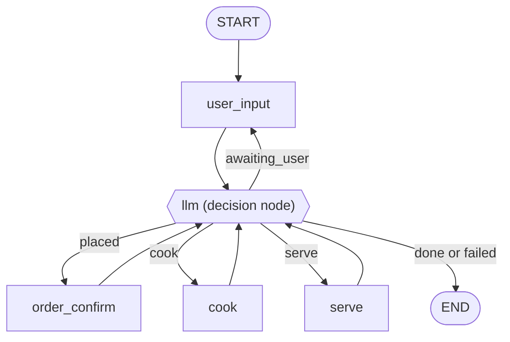

# Restaurant Order Agent (LangGraph)

An AI agent that automates a restaurant order flow, in the style of Zomato or Swiggy. A customer types an order in plain English, and the agent carries it through **stock check, cooking, and delivery**, with retry limits and a defined outcome for every failure.

Instead of relying on one big prompt, the whole process is built as a **deterministic, graph-based workflow** with typed shared state, conditional routing, and capped retries.

---

## Features

- Understands natural-language orders such as "I want 2 margherita pizzas" and extracts the dish and quantity
- Rejects anything that is not about food ordering (guardrail)
- Fixes typos and variations in dish names ("piza" becomes "pizza")
- Handles full, partial, and zero stock, and lets the customer accept a smaller quantity
- Retries failed cooking and delivery within fixed limits, then cancels with an apology
- Always ends with a recorded result: `COMPLETED` or `NOT COMPLETED: <reason>`
- Scripted test scenarios through `simulate()`, with fake user input and pre-set cook and serve results

---

## Workflow



The graph has **5 nodes** and a hub-and-spoke design. Every worker node reports back to the `llm` node by writing a `status`. The `llm` node is the only decision-maker: it reads the status and the retry counters, writes the message for the customer, and chooses the next node.

| Node | What it does |
|------|--------------|
| `user_input` | Reads the customer's next message from the terminal |
| `llm` | The brain. Parses the message, talks to the customer, spends retries, and picks the next step |
| `order_confirm` | Fuzzy-matches the dish against the menu and checks stock |
| `cook` | Simulated kitchen with a 60% success chance |
| `serve` | Simulated delivery with a 60% success chance |

### Step by step

1. **Order intake.** The customer places an order. The LLM extracts the dish and quantity, or flags the message as unrelated to food.
2. **Stock check.** `order_confirm` marks the order as fully available, partially available, or unavailable.
   - Fully available: goes straight to cooking.
   - Partial: the agent offers the smaller quantity or a new order.
   - Unavailable: the agent asks for a different order.
3. **Cooking.** On success the dish is ready. On failure the agent retries, up to the cook limit.
4. **Delivery.** On success the order is complete. On failure the dish is cooked again and re-served, if retries remain.
5. **Result.** The state stores `COMPLETED` or the exact reason the order failed.

---

## Shared state

All nodes read and write one typed state object.

| Field | Purpose |
|-------|---------|
| `messages` | Conversation log (append-only, using the `add_messages` reducer) |
| `order` | Dish name, required quantity, available quantity |
| `status` | Current step, restricted to 14 allowed values with `Literal` |
| `order_retries` | Order attempts left |
| `cook_retries` | Cook re-runs left |
| `serve_retries` | Serve re-runs left |
| `final_result` | `COMPLETED` or `NOT COMPLETED: <reason>` |

### The 14 statuses

| Written by | Statuses |
|-----------|----------|
| Initial state | `new` |
| `order_confirm` | `confirmed`, `partial`, `unavailable` |
| `cook` | `ready`, `cook_failed` |
| `serve` | `complete`, `serve_failed` |
| `llm` (routing decision) | `awaiting_user`, `placed`, `cook`, `serve`, `done`, `failed` |

---

## Retry limits

| Limit | Value | What costs one retry |
|-------|-------|----------------------|
| Order attempts | 3 | An unrelated message, a partial result, or an unavailable dish |
| Cook retries | 2 | Every re-cook, including a re-cook caused by a failed delivery |
| Serve retries | 2 | Every re-serve (a failed delivery needs one cook retry and one serve retry) |

When a limit runs out, the agent apologises and ends the session with a specific failure reason. A `recursion_limit` of 100 on the graph acts as a final safety net against infinite loops.

---

## Concepts and algorithms used

- **Graph-based agent orchestration.** LangGraph nodes and edges make the control flow explicit instead of hiding it in a prompt.
- **State machine with conditional routing.** A router function, `route_after_llm`, maps the status to the next node or to `END`.
- **Structured output with Pydantic.** The `OrderIntent` model forces the LLM to return `new_order`, `accept_partial`, or `unrelated`, plus the dish and quantity, instead of free text. It uses `llm.with_structured_output`.
- **Prompt engineering and guardrails.** The extraction prompt includes the live menu and whether a partial offer is pending, so a plain "yes" is understood correctly. Off-topic requests are rejected.
- **Separation of parsing and replying.** One LLM call extracts data and a separate `say()` helper writes each customer-facing message, both at temperature 0.
- **Fuzzy dish matching.** Three steps: exact match, then substring match in either direction, then `difflib.get_close_matches` with a 0.6 similarity cutoff.
- **Retry budgets and loop prevention.** Separate counters for order, cook, and serve, all managed in one place (the `llm` node).
- **Probabilistic simulation.** Cooking and delivery are mocked with a 60% success coin flip, so failure paths can be tested without real systems.
- **Dependency injection for testing.** `input_fn`, `cook_outcomes`, and `serve_outcomes` are passed through the LangGraph config, which makes scenarios repeatable.
- **Streaming.** `graph.stream(..., stream_mode="values")` prints each agent message as it is produced.

---

## Tech stack

| Area | Tools |
|------|-------|
| Language | Python 3.10 or newer |
| Agent framework | LangGraph, LangChain Core |
| LLM | `openai/gpt-oss-120b` through the Groq API (`langchain-groq`), temperature 0 |
| Validation | Pydantic |
| Config | python-dotenv |
| Package manager | uv |
| Standard library | difflib, random, os, sys, typing |

---

## Project structure

```
resturentProject/
├── main.py            # Full agent: menu, state, nodes, graph, runner
├── prompt.md          # Specification prompt used to generate the code
├── pyproject.toml     # Project and dependency definition
├── uv.lock            # Locked dependency versions
├── .env.example       # Template for the API key
├── .gitignore
└── README.md
```

---

## Getting started

**1. Clone the repository**

```bash
git clone https://github.com/YOUR_USERNAME/restaurant-order-agent-langgraph.git
cd restaurant-order-agent-langgraph
```

**2. Install dependencies**

```bash
uv sync
```

or with pip:

```bash
pip install langgraph langchain-groq python-dotenv
```

**3. Add your Groq API key.** Create a `.env` file in the project folder:

```
GROQ_API_KEY=your_key_here
```

You can get a free key from the Groq console.

**4. Run the agent**

```bash
uv run main.py
```

or:

```bash
python main.py
```

The menu is printed and the agent waits for your order.

---

## Menu

| Dish | Stock |
|------|-------|
| pizza | 5 |
| burger | 3 |
| biryani | 10 |
| dosa | 2 |
| pasta | 0 (sold out) |

---

## Try the scripted scenarios

`simulate()` runs the real graph with fake user replies and pre-set cook and serve results.

**Partial stock, customer accepts, everything succeeds**

```python
from main import simulate

simulate(
    ["I want 5 burgers", "yes, go ahead"],
    cook_outcomes=[True],
    serve_outcomes=[True],
)
```

**Cooking fails until retries run out**

```python
simulate(["2 pizzas"], cook_outcomes=[False, False, False])
```

Once the scripted list is used up, the outcome goes back to the random 60/40 flip.

---

## Sample run

<!-- Replace this block with the output of your own run -->

```
Paste the terminal output of a real run here
```

---

## Design decisions

- **One decision-maker.** Worker nodes only report what happened. All routing and retry spending lives in the `llm` node, so the rules sit in one place.
- **Typed state.** `Literal` types and `TypedDict` make an invalid status or a missing field easy to catch.
- **Explicit failure outcomes.** Every path ends in `done` or `failed` with a recorded reason, never a silent stop.
- **Specification-driven build.** The graph, state, and failure cases were designed first on paper, then written up as a specification (`prompt.md`) and used to generate the code.

---

## Possible improvements

- Add automated tests with pytest on top of `simulate()`
- Move stock into a database and give the agent tools to query it
- Add a LangGraph checkpointer so sessions can be saved and resumed
- Build a web or chat front end

---

Built by **Abhimunnya Dey**.